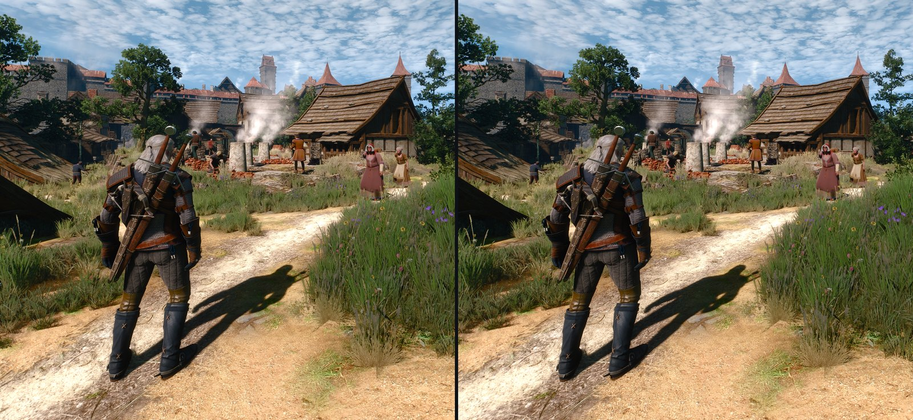
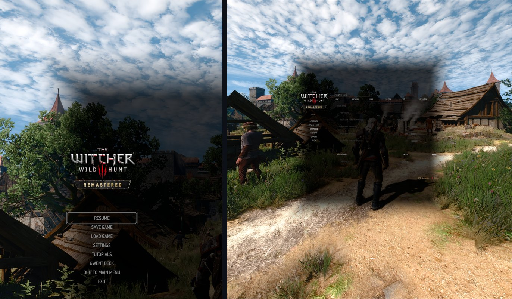
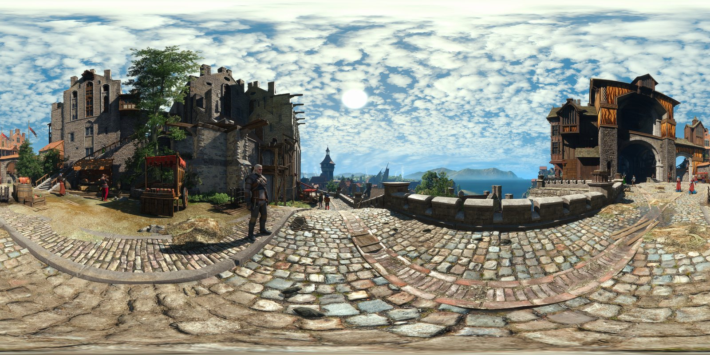

# Witcher 3 Remastered VR

> This is an unofficial fan work and is not approved/endorsed by CD PROJEKT RED.

Play *The Witcher 3: Wild Hunt* Remastered (patch 5.01) in full 3D VR: sharp DLSS in both eyes,
menus that float in the room, and a HUD you can read. Free and open source. This project continues
the [Witcher 3 VR](https://github.com/tig3rmast3r/witcher3-vr) mod by tig3rmast3r and the
[Remastered port](https://github.com/joschi127/witcher3-vr/tree/remaster) by joschi127.



## Does it work for me?

| | Setup |
|---|---|
| ✅ **Polished, played regularly** | Linux (Bazzite) · Steam + Proton · NVIDIA RTX 3080 · Meta Quest 3 through WiVRn · DLSS Quality or DLAA |
| 🟡 **Should work, not tested yet** | Windows · SteamVR · other headsets · AMD/Intel GPUs (FSR) · SteamOS / Steam Deck · GOG edition |
| ❌ **Not supported** | Game versions other than 5.01 (the mod then switches itself off) · VR motion controllers |

On the tested setup it is a complete, polished experience. Nobody has tried the other setups yet, so
expect rough edges there, and please [tell us](https://github.com/kaarele/witcher3-remastered-vr/issues)
how it goes.

## Simple install

1. Download the latest zip from **[Releases](https://github.com/kaarele/witcher3-remastered-vr/releases)**.
2. Extract it anywhere and open **Install (Linux)**, or **Install (Windows)** (experimental).
3. Start WiVRn (or your VR runtime), connect the headset and start the game from Steam.

To remove the mod, open **Uninstall**. Your saves are never touched.

<details>
<summary>What the installer does, and what to do if it doesn't start</summary>

The installer finds the game in Steam (on Linux also Flatpak and Snap Steam), backs up your saves, copies the mod
and writes the tested VR graphics settings (DLSS Quality on NVIDIA). On Linux it also sets the Steam launch options;
Steam has to be closed for that, otherwise it shows the line to paste. Everything comes from the zip; nothing is
downloaded. Running it again updates the mod and keeps your render size and DLSS mode.

- **Linux:** if the file opens as text, right-click it and choose *Run* (GNOME: *Allow Launching*), or run
  `installer/install.sh` in a terminal. Tested setup: Bazzite, Steam + Proton, WiVRn.
- **Windows** (not tested yet, so please report how it goes): if Windows asks whether to run it, choose *Run*
  (*More info > Run anyway*). The installer only uses the files in that folder.

**Uninstall:** open **Uninstall (Linux)** or **Uninstall (Windows)**, from the extracted folder or from the
`Witcher3VR` folder in the game folder. It removes the mod files and restores the graphics settings and Steam
launch options the installer changed. Your saves are never touched.

<details>
<summary>Manual install (without the installer)</summary>

1. Copy everything inside the zip's `payload` folder into the game folder (Steam: right-click *The Witcher 3* >
   **Manage** > **Browse local files**) and merge the folders.
2. Linux: close the game, open a terminal in the game folder and run
   ```bash
   python3 Witcher3VR/linux/w3vr-linux.py backup-saves
   python3 Witcher3VR/linux/w3vr-linux.py configure
   python3 Witcher3VR/linux/w3vr-linux.py launch-options
   ```
   and paste the printed line into Steam > *The Witcher 3* > **Properties** > **Launch Options**.
3. Windows: start the game, and in **Options > Graphics** set Anti-aliasing to **DLSS** (Quality or DLAA), and
   turn **sharpening**, **NVIDIA Reflex** and **frame generation** off.

Uninstall by hand: delete `bin/x64_dx12/dxgi.dll` in the game folder. On Linux,
`python3 Witcher3VR/linux/w3vr-linux.py uninstall --restore-settings` also puts your graphics settings back.
</details>

</details>

## What you get



- **Full 3D with sharp DLSS in both eyes**, playable even on DLSS Balanced. Quality or DLAA look best.
- **The pause menu floats over the live 3D world.** In the graphics settings you can look around
  and see every change as you make it.
- **The main menu and loading screens are a big screen in the room,** with a 360° 3D picture of the
  game world around it instead of a black void.
- **"Press A to talk" labels sit at the person's real depth.** HUD, menus and subtitles stay readable.
- **Optional:** capture your own 3D 360° pictures in the game (pause menu + `F4`). They join the
  loading-screen rotation.



**Controls:** no F keys are needed: the mod starts in the right mode. Play with mouse and keyboard,
a gamepad or a Steam Controller (tested with the 2026 Steam Controller); VR motion controllers are
not supported. Optional keys: F9 recentres the view (look straight ahead first), F8 toggles the
near view, F10 the cinema screen, F11 first person.

## What works and what's next (details)

**Works, tested in the headset:** Linux (Bazzite), Steam, Proton Hotfix, NVIDIA RTX 3080, Meta Quest
3 through WiVRn at 90 Hz.
- Full stereo 3D with DLSS/DLAA kept separately for each eye, and a sharp per-eye projection.
- **DLSS looks clean in both eyes.** Both eyes get the same DLSS jitter and the same shadow noise,
  and the eye that is rendered second keeps the motion of moving characters. Before, the left eye
  was jagged and flickered on moving characters (Geralt's armour). Balanced is now playable without
  artifacts; Quality or DLAA look best.
- **"Press A to talk" labels appear at the person's real depth**, not on a flat HUD plane.
- HUD, menus and loading screens placed where you can read them. "Press A to talk" style markers
  sit on the people and objects they belong to.
- No black rectangles when cutscenes or loading screens fade.
- Geralt stays centred in front of you, also after cutscenes.
- Shadows and flickering lights look the same in both eyes.
- About 15% more frames per second with DLSS Quality: the game prepares the next frame early, and
  both eyes still show every character in the same pose. (With DLAA the graphics card is the limit,
  so it gains nothing there.)
- People keep animating when you look at them with your head rather than the game camera, also
  background people beside or behind you.
- **See-through pause menu.** The whole in-game pause menu (Back / Esc) floats over the live 3D
  world on a soft dark panel. In the graphics settings you can look around and see every change as
  you make it. Inventory, map and the other panels keep their black background.
- **Main menu and loading screens on a big screen in the room**, fixed where you look when it
  appears, with a 360° 3D picture around it instead of a black void (a Novigrad view captured in the
  game ships with the mod). `F9` brings the screen back in front of you.
- **Your own 360° pictures** (opt-in): set `capture360_enabled=1`, open the pause menu where you like
  the view and press `F4`. Keep still for about 30-40 seconds (the headset stays dark meanwhile).
  The 3D picture lands in the loading-screen rotation. Tip: turn the camera to face Geralt first; the
  picture is saved with him 60° to the left, beside the loading screen.
- **FSR works in Stereo**, with its own history for each eye. On NVIDIA the game uses its built-in
  FSR 2, which works but costs a lot of performance there, so DLSS is the better choice on NVIDIA.
  AMD owners: please try FSR and report how it runs.

**Coming soon:**
- SteamVR, on Linux and Windows (prepared, not tested yet; see [SteamVR on Linux](#linux-steam--proton)).
- Windows in general (the code and the installer should work, but nobody has run them yet).
- More detail close up: some objects and characters switch to their simpler versions too early in VR.
- A photo-mode button for 360° pictures.
- A picture for the story recap while a save loads (black in VR for now).

**Not tested:** AMD and Intel GPUs (use FSR or FXAA there; reports very welcome), headsets other than
Quest 3, the GOG edition, SteamOS / Steam Deck.

**Known issues:** loading a save looks very slow, but most of the wait is the game's story recap
video, which stays black in VR. The game itself has usually loaded after 20 to 25 seconds: press
**Space** on the keyboard or **X** on the gamepad to skip the recap. FSR on NVIDIA costs a lot of
frames. In VR some objects and characters switch to their simpler versions (level of detail) quite close
up, for example round barrels look angular a few metres away. In
first person (`F11`) the camera sits inside Geralt's head (an experimental fix is in the
[configuration reference](#configuration-reference)). More in
[Troubleshooting and known issues](#troubleshooting-and-known-issues).

## Why this mod exists

> I didn't find a working VR version for the game for the Remastered version nor something that
> would work on a normal OS, so I asked Opus 5.5 to make one. It's 99% of its doing plus 1% of my
> oversight and creative decisions on the VR taste. Tokens ain't free, so if you want this mod to
> keep improving, consider donating or feel free to fork the repo and have fun with all the bugs.
>
> — kaarele ([ko-fi.com/kaarele](https://ko-fi.com/kaarele))

## Contributing

Collaborators are welcome. Anyone can fork this repository and open a pull request: fixes,
Windows fixes and test reports from other setups (SteamVR, other headsets, AMD/Intel GPUs) are
especially welcome. For a bug, open an [issue](https://github.com/kaarele/witcher3-remastered-vr/issues)
with your OS, GPU, headset, OpenXR runtime and what you saw. See [CONTRIBUTING.md](CONTRIBUTING.md).

## Contents

- [Does it work for me?](#does-it-work-for-me)
- [Simple install](#simple-install)
- [What you get](#what-you-get)
- [What works and what's next (details)](#what-works-and-whats-next-details)
- [Why this mod exists](#why-this-mod-exists)
- [Contributing](#contributing)
- [What this project adds](#what-this-project-adds)
- [Requirements](#requirements)
- [Installation](#installation)
- [Recommended settings](#recommended-settings)
- [Controls](#controls)
- [Configuration reference](#configuration-reference)
- [Platform support](#platform-support)
- [Troubleshooting and known issues](#troubleshooting-and-known-issues)
- [Building from source](#building-from-source)
- [Headless testing (for developers)](#headless-testing-for-developers)
- [Documentation](#documentation)
- [Reporting problems](#reporting-problems)
- [Support the project](#support-the-project)
- [License and credits](#license-and-credits)

## What this project adds

Everything the Remastered port offers on 5.01 is still there: Stereo and Mono rendering, the VR
HUD, cutscenes and cinema modes, the near view and the launcher. The full upstream feature
description is in the
[README of the Remastered port](https://github.com/joschi127/witcher3-vr/blob/remaster/README.md).
On top of that, this project adds the features below. Some of them have so far only been tested
without a headset; the [feature status table](#platform-support) shows which.

**Linux**
- Runs under Steam + Proton. A setup tool (`linux/w3vr-linux.py`, Python 3, standard library only)
  replaces the Windows launcher: it finds the game, backs up your saves, installs the mod, writes a
  tested VR preset and prints the Steam launch options for your OpenXR runtime.
- The DLL can be built on Linux with clang-cl inside a distrobox container.

**Image quality**
- **DLSS on Remastered 5.01, with its own history for each eye.** In Stereo the game would run
  both eyes through one DLSS history, which blends the two eye images. The mod gives each eye its
  own DLSS viewport, history and motion-vector camera. DLSS Quality, Balanced, Performance, Ultra
  Performance and DLAA can all be used (tested under Proton only).
- **DLSS under Proton.** The game normally skips its DLSS setup when it detects Wine. The mod
  removes that check in memory at startup (only on the exact 5.01 build it knows).
- **Per-eye projection** (`remaster_asymmetric_ndc`, set by the Linux tool). Each eye is rendered
  with its own off-centre field of view and the whole image goes to the headset. Without it, each
  eye renders a wider centred image and about a third of it is cropped away, so the same render
  size looks noticeably sharper with it.
- **Sharp, readable HUD.** A shrunk HUD is filtered instead of skipping pixels, so text no longer
  breaks up and crawls when you move your head.

**HUD, menus and markers**
- The controller-locked HUD stays level (it follows your heading, not the tilt of your head when
  you recentred).
- The HUD, menus and loading screens are centred on the part of the image you actually see.
- No more black HUD-sized rectangle when a cutscene or loading screen fades to black.
- Interaction prompts and NPC or door markers sit on their targets instead of floating too high
  and moving with the camera pitch.
- The pause menu no longer jitters left and right in Stereo.

**Camera**
- The near view centres Geralt in front of you, instead of the game's over-the-shoulder framing.
- After a cutscene, gameplay keeps the forward direction it had before the cutscene.
- The setup tool and the launcher select the game's *Close* exploration and combat cameras. The
  default 5.01 camera re-frames while walking, which looks like zooming in and out in VR.

**Performance** (the game is CPU-limited in VR because it renders the scene twice per frame)
- Much less CPU overhead from the mod's own descriptor tracking on the render thread (on by
  default).
- One-pair run-ahead (on in the release's settings): the game prepares the next frame while the
  current one renders, about 15% more frames per second when the CPU is the limit (DLSS Quality).
  The second eye is queued after the game's own frame fence, so both eyes show the same animation
  poses (`pair_enqueue_after_fence`).
- Shared sun shadows (on in the release's settings): the second eye reuses the first eye's
  sun-shadow maps.
- People the headset sees but the game camera doesn't keep animating (`animated_component_visible`).

**Consistency between the eyes** (optional)
- Flickering lights (torches, candles, fires) flicker the same in both eyes and at the normal
  speed.
- Local shadows are chosen the same way for both eyes, so a shadow no longer shows in one eye
  only.

**For developers**
- A headless OpenXR runtime (`tools/w3vr-nullxr`) runs the full VR path without a headset,
  including under Proton, and saves the images a compositor would receive.

## Requirements

- *The Witcher 3: Wild Hunt*, Remastered, **patch 5.01**, DirectX 12, legally obtained. The Steam
  edition is tested. The mod checks the game build at startup and does nothing on other builds.
- A VR headset with an **OpenXR runtime**. Tested: WiVRn on Linux. Others (SteamVR, Meta Quest
  Link, Virtual Desktop, Monado, ...) are untested.
- Mouse and keyboard, a gamepad, or a Steam Controller (tested with the 2026 Steam Controller). VR
  motion controllers are not supported.
- For DLSS: an NVIDIA GeForce RTX GPU. Other GPUs can use FXAA (untested by this project). On AMD
  GPUs, use a current Adrenalin driver: older drivers render some 5.x grass solid black, with or
  without the mod.
- A strong desktop CPU. In Stereo the game renders every frame twice and is mostly CPU-limited.
- **Linux:** Steam with Proton (Proton Hotfix is tested) and Python 3, which SteamOS, Bazzite and
  most desktop distributions already include.
- **Windows:** Windows 10 or 11 (untested). The mod links the C++ runtime statically, so no Visual
  C++ Redistributable is needed for it.

## Installation

> [!IMPORTANT]
> Back up your saves before you install anything. On Windows they are in
> `Documents\The Witcher 3\gamesaves`. On Linux they are in
> `steamapps/compatdata/292030/pfx/drive_c/users/steamuser/Documents/The Witcher 3/gamesaves`
> inside the Steam library that holds the game. The Linux tool also makes and verifies a backup
> before it changes anything.

### Before you start

- Stay on Steam's default branch (patch 5.01). Do not switch to the `next-gen` (4.04) branch.
- **Start the game once without the mod**, reach the main menu and quit. This creates the
  settings files the setup edits (`dx12user.settings` and `input.settings`) and, on Linux, the
  Proton prefix.
- **Close the game** before you install, configure or uninstall. The game rewrites its settings
  files when it exits.

The mod adds these files to the game folder. It is not meant to replace game files (but see the
[Windows launcher problems](#windows-untested) below), and the Linux tool backs up any existing
file before it overwrites it:

| Where | What |
|---|---|
| `bin/x64_dx12/dxgi.dll` | The VR renderer (a DXGI proxy). Setup copies it here from `bin/x64_dx12/witcher3vr-mod-reference/`. |
| `bin/x64_dx12/openxr_loader.dll` | The Khronos OpenXR loader |
| `bin/x64_dx12/witcher3vr.ini` | The mod's settings, written by the launcher or the Linux tool |
| `mods/modWitcher3VR*`, `mods/modW3VRKeepHudFrameScale` | Script mods: state bridge, first person, HUD editor, HUD scale guard |
| `bin/config/r4game/user_config_matrix/pc/modWitcher3VRHUDEditor.xml` | HUD editor menu |

### Linux (Steam + Proton)

1. **Get the files.** The easy way: the release zip's **Install (Linux)**, as in
   [How to install?](#simple-install); it does steps 1 to 5 for you. By hand: copy the zip's `payload` folder into
   the game folder. It contains
   everything below, including `openxr_loader.dll`, the 5.01 script mods and the setup tool
   (`Witcher3VR/linux/w3vr-linux.py`). To use your own build instead, build `dxgi.dll` (see
   [Building from source](#linux-clang-cl-in-a-distrobox)) and pass it with `install --dll`.
2. **Check the download** (optional): `sha256sum -c SHA256SUMS.txt --ignore-missing`.
3. **Connect your headset to WiVRn** (or start your OpenXR runtime). WiVRn only registers itself as
   the active OpenXR runtime while a headset is connected.
4. From the game folder (or a checkout of this repository, using `linux/w3vr-linux.py`), run:

   ```bash
   python3 linux/w3vr-linux.py status        # Steam, game folder, game build, OpenXR runtime
   python3 linux/w3vr-linux.py install <release>.zip --dll <path/to/your/dxgi.dll>   # only for your own build
   python3 linux/w3vr-linux.py configure     # the tested 5.01 preset; see configure --help
   python3 linux/w3vr-linux.py launch-options
   python3 linux/w3vr-linux.py wivrn-shortcut   # optional: list the game in WiVRn's in-headset launcher
   ```

   - `install` backs up and verifies your saves, copies the files, activates `dxgi.dll` and installs
     the 5.01 versions of the scripts plus the HUD scale guard.
   - `configure` writes the preset to `witcher3vr.ini` and only the keys it needs to
     `dx12user.settings`, and registers the HUD editor. It keeps a backup of every file it changes.
     The preset: strict Stereo, the game's DLSS on NVIDIA (FXAA otherwise), per-eye projection,
     the Close cameras, a half-size controller-locked HUD and the near view.
   - `configure` uses WiVRn's recommended Quest 3 render size (2476x2594 per eye). For another
     headset pass `--res WIDTHxHEIGHT` with your runtime's recommended per-eye size.
   - `--dlss-quality` selects the DLSS mode: 1 Quality (default), 2 Balanced, 3 Performance,
     4 Ultra Performance, 0 DLAA. You can also change it in the game's graphics options at any time.

5. **Set the launch options** in Steam: *The Witcher 3 > Properties > General > Launch Options*.
   `launch-options` prints the OpenXR part for your runtime. This is the full line tested with
   WiVRn installed as a system-wide Flatpak:

   ```text
   PRESSURE_VESSEL_IMPORT_OPENXR_1_RUNTIMES=1 PRESSURE_VESSEL_FILESYSTEMS_RW=/var/lib/flatpak/app/io.github.wivrn.wivrn WINEDLLOVERRIDES="dxgi=n,b" PROTON_ENABLE_NVAPI=1 %command% --launcher-skip
   ```

   - The two `PRESSURE_VESSEL_*` variables let the game reach the OpenXR runtime on the host.
     `PRESSURE_VESSEL_FILESYSTEMS_RW` is only needed for a Flatpak WiVRn; for a per-user Flatpak
     install the path is under `~/.local/share/flatpak/app/`.
   - `WINEDLLOVERRIDES` makes sure the mod's `dxgi.dll` is loaded, and `PROTON_ENABLE_NVAPI=1`
     makes NVAPI available for DLSS. Proton Hotfix already sets both for this game on NVIDIA
     systems, so there they are redundant but harmless.
   - `--launcher-skip` starts the DirectX 12 game directly, without the REDlauncher window.

6. **Play:** with the headset connected, start the game from Steam or from WiVRn's app list in the
   headset. Proton sets up VR once, at launch.

**SteamVR on Linux (experimental, not tested in the headset yet):** start SteamVR and connect the
headset first (for a Quest: the Steam Link app). Then run `python3 linux/w3vr-linux.py configure --res runtime`
and `python3 linux/w3vr-linux.py launch-options --runtime steamvr`; the printed line adds
`XR_RUNTIME_JSON=".../SteamVR/steamxr_linux64.json"`, so the game uses SteamVR even when WiVRn is
installed. SteamVR's per-application resolution setting then decides the render size.

**Uninstall:** with the game closed, run `python3 linux/w3vr-linux.py uninstall --restore-settings`
and clear the launch options in Steam. Your saves are not touched. Deleting
`bin/x64_dx12/dxgi.dll` alone also switches the mod off.

More details: [LINUX.md](LINUX.md).

### Windows (untested)

Nobody has run this project on Windows yet. If you try it, please [report](#reporting-problems) what
happens, good or bad.

1. Extract the release zip from [Releases](https://github.com/kaarele/witcher3-remastered-vr/releases) anywhere and open
   **Install (Windows)** (it does step 3 for you). By hand: copy the zip's `payload` folder into the game folder
   (the folder that contains `bin`, `content` and `mods`) and merge the folders.
2. Make sure your headset's OpenXR runtime is the active one (SteamVR, Meta Quest Link, Virtual
   Desktop, ...), then start the game.
3. In **Options → Graphics**: Anti-aliasing **DLSS** (Quality or DLAA) on an RTX GPU, otherwise
   **FXAA**; sharpening, NVIDIA Reflex and frame generation **off**.
4. The included `bin\x64_dx12\witcher3vr.ini` is the tested Quest 3 setup (2476x2594 per eye).
   For another headset, set `render_width` and `render_height` under `[openxr]` to your runtime's
   recommended per-eye size.

The upstream Windows launcher (`launcher/`) is not part of the release yet: on 5.01 it has known
problems (it expects `dx12filelist.txt`, which Steam 5.01 does not have, and its *Off* mode removes
the game's `amd_fidelityfx_framegeneration_dx12.dll`).

**Uninstall:** delete `bin\x64_dx12\dxgi.dll` (this alone switches the mod off), then
`bin\x64_dx12\openxr_loader.dll`, `bin\x64_dx12\witcher3vr.ini`, the `Witcher3VR` folder, the
`mods\modWitcher3VR*` and `mods\modW3VRKeepHudFrameScale` folders and
`bin\config\r4game\user_config_matrix\pc\modWitcher3VRHUDEditor.xml`.

### Releases

Each release on the [Releases page](https://github.com/kaarele/witcher3-remastered-vr/releases) has:

- `Witcher3RemasteredVR-<version>.zip`: one package for Windows and Linux. Extract it anywhere and open
  **Install (Linux)** or **Install (Windows)**; **Uninstall (…)** undoes it. Its `payload` folder mirrors the game
  folder for a manual install. It replaces no game files.
- `SHA256SUMS.txt`: checksums. Check with `sha256sum -c SHA256SUMS.txt --ignore-missing` on Linux,
  or `Get-FileHash` in PowerShell on Windows.

The package needs no other software (no Visual C++ Redistributable, no .NET; Linux uses the system's
Python 3). It contains no NVIDIA files: DLSS uses the files that come with the game and the
driver. The files are not code-signed, so Windows SmartScreen may warn (**More info** → **Run
anyway**). Game updates change the game build; the mod then switches itself off until a release
supports the new build; running the installer of that release updates the mod.

## Recommended settings

### Headset and OpenXR runtime

- **Refresh rate:** set it in your runtime. With WiVRn (set in the headset app), 90 Hz worked best on
  the test setup. At 120 Hz the video stream could not keep up there and the picture turned blocky.
- **Stream quality:** WiVRn's bitrate, render scale and foveation settings decide how sharp the
  streamed image is. On the test setup a higher bitrate made a visible difference.
- Connect the headset **before** you start the game.

### In-game graphics

| Setting | Recommendation |
|---|---|
| Anti-aliasing | **DLSS** on an RTX GPU. Otherwise **FSR** (one history per eye, `remaster_fsr_per_eye=1` in the release ini; on NVIDIA it works but is slow) or **FXAA**. XeSS and TAA keep one history for both eyes and ghost in Stereo. |
| DLSS mode | **DLAA** or **Quality** look best; **Balanced** is playable without artifacts. All three were used on the test setup (RTX 3080). There the frame rate was mostly limited by the CPU, so the faster DLSS modes gained little. |
| Sharpening | Off. It adds shimmer after the headset stream's resampling. |
| Frame generation, Reflex, ray reconstruction | Off. The mod presents its own eye pairs. The launcher and the Linux tool switch them off. |
| Ray tracing | Off |
| Light shafts | Off. With the sun in view they lay a bright veil over the whole image in VR. |
| Exploration and combat camera | *Close* (set by the launcher and the Linux tool) |
| Motion blur, blur, lens effects | Off |
| Foliage visibility range, grass density | These cost the most CPU in VR. Lower them first if the frame rate drops in towns or forests. |

The launcher's **World Detail Range** setting only affects 4.04; it has no effect on 5.01.

### Why the frame rate moves in steps

A headset display refreshes at a fixed rate and has no variable refresh rate (VRR). Each refresh
shows the newest finished stereo pair (both eyes), re-aimed to your current head pose by the
runtime, so turning your head stays smooth even when the game is slower. But if the game delivers,
say, 40 pairs per second at 90 Hz, some pairs stay on screen for two refreshes and others for
three, and camera and animation motion look slightly uneven. Motion is smoothest when the game runs
at or just below half the refresh rate (about 44-45 pairs per second at 90 Hz). In Stereo the game
presents each eye separately, so the Steam FPS counter shows twice the pair rate.

### Optional settings (not yet default)

The Linux tool's `configure` writes the tested preset. Among other things it sets these keys
(`temporal_backend=dlss` on NVIDIA; on other GPUs it writes `none`, which means FXAA):

```ini
[openxr]
hud_size=0.500
hud_stereo_shift_px=-72
hud_controller_locked=1

[engine]
temporal_backend=dlss
remaster_asymmetric_ndc=1
camera_mode=1
close_camera_offset=-1.000
```

On 5.01 it also adds these keys when they are missing (your own values are kept):

```ini
[openxr]
world_marker_depth=1

[engine]
remaster_pair_jitter=1
remaster_pair_noise=1
remaster_pair_previous_transforms=1
dlss_mip_bias_offset=0.5
async_anim_tick_visible=1
remaster_fsr_per_eye=1
```

The values below are **not the code defaults**, but the release's `bin/x64_dx12/witcher3vr.ini`
already contains them and they are what the test setup plays with. If you build the DLL yourself
or start from another ini, add them with the game closed. See the
[Configuration reference](#configuration-reference) for what each one does.

```ini
[engine]
remaster_asymmetric_ndc_cascade_fix=0
remaster_shadow_pair_reuse=1
remaster_light_flicker_per_pair=1
remaster_local_light_pair_lock=1

[perf]
pair_barrier_lag=1
pair_enqueue_after_fence=1
```

Keep `[debug] logging_enabled` and `runtime_diagnostics` at `0` for playing; diagnostics cost a lot
of performance.

## Controls

You don't need any of these keys to play: the mod starts in Stereo with the near view and a
controller-locked HUD. These keys come from the original mod. `F9` is used on the test setup. The other keys have not
all been re-tested in the headset on 5.01 by this project; `F11` and the HUD editor have not been
tested on 5.01 at all yet.

| Key | Action |
|---|---|
| `F9` | Recenter the view. Configurable with `[openxr] recenter_key` (for example `F5` or `Space`). |
| `F8` | Switch between the game's shoulder camera and the near view. On 5.01 the near view centres Geralt in front of you. |
| `F10` | Toggle Cinema mode (the game on a flat virtual screen) |
| `F11` | Toggle first person |
| `F7` | Switch between the VR and Cinema3D HUD layouts |
| `Insert` | Open the HUD editor, or save and close it |
| `F3` | Write the recent route and performance log events (with diagnostics on) |

In the HUD editor: `Q` / `E` select a panel, the arrow keys move it, the mouse wheel resizes it,
`R` resets the panel and `X` resets the whole layout.

`F2` switches the 4.04 projection path. It is not meant for 5.01, where the projection is set by
`remaster_asymmetric_ndc`.

## Configuration reference

All keys live in `bin/x64_dx12/witcher3vr.ini`. The table lists the keys this project added or
changed. The `remaster_*` keys, `hud_fade_mode`, `world_marker_exact_projection`,
`hud_centre_split_aim_only`, `world_marker_depth` and `[perf] pair_barrier_lag` only act on the 5.01 build. The others
also apply to 4.04, where this project has not re-tested them. Change them with the game closed.
The original mod's keys are documented in [witcher3vr.example.ini](witcher3vr.example.ini).

### `[openxr]`

| Key | Default | What it does |
|---|---|---|
| `render_size_from_runtime` | `0` | `1` = at every start, render at the OpenXR runtime's recommended per-eye size (times `resolution_scale`) instead of `render_width`/`render_height`; those stay as the fallback. For SteamVR this follows its resolution setting. The Linux tool sets it with `configure --res runtime`. Clamped to 800-4096 px. Not tested in the headset yet. |
| `hud_fade_mode` | `remove` | The game draws its fade to black into the HUD texture, which shows as a black rectangle in VR. `remove`: drop that fill, the world stays visible. `uniform`: darken each whole eye image instead. `native`: the game's own draw. Menus, loading screens and Cinema panels always keep the native fade. |
| `hud_filtered_sampling` | `1` | Filter the HUD when it is shrunk (`hud_size` below 1), so text stays readable. All builds. |
| `hud_anchor_level` | `1` | The controller-locked HUD keeps only your heading from the recenter, not head pitch or roll. All builds. |
| `hud_scale_origin` | `visible` | `visible`: `hud_size` shrinks the HUD toward the centre of the visible image. `render`: toward the straight-ahead axis (old behaviour). All builds. |
| `menu_vertical_center` | `visible` | `visible`: menus and loading screens are centred on the visible image. `forward`: old behaviour. All builds. |
| `menu_world_locked` | `0` | Release ini and installer: `1`, tested in the headset. `1`: the main menu, loading screens and the loading video appear as one world-locked screen (like a big TV in front of you) instead of a panel that follows your head. Looking around no longer moves it. Re-anchored with `F9` or when your head moves more than `menu_world_reanchor_distance` (default `0.5` m) from where it was anchored. In-game menus are unchanged. Not tested in the headset yet. |
| `menu_world_aspect` | `1.7778` | With `menu_world_locked=1`: width/height of the picture on the world screen. The game draws its menus letterboxed; 16:9 cuts the black bars above and below off. `0` = the whole image. |
| `menu_world_distance`, `menu_world_width` | `2.5`, `3.6` | Distance and width of that screen in metres. |
| `menu_world_pitch_offset` | `5` | Degrees the world screen is raised above the menus' slightly downward-tilted centre; it keeps facing you. |
| `menu_world_follow` | `0` | With `menu_world_locked=1`: `1` = lazy follow. When you look more than `menu_world_follow_angle` (default `25`) degrees away from the screen for `menu_world_follow_delay` (`0.8`) seconds, the screen glides back in front of you over `menu_world_follow_time` (`0.6`) seconds. `0` (default) = the screen stays where it was anchored, in front of you; `F9` re-centres it. |
| `options_menu_see_through` | `0` | Release ini and installer: `1`, tested in the headset. 5.01. `1`: while the in-game **pause menu** is open (its main list and all its settings pages except the HDR calibration page), the world keeps rendering in stereo behind the menu and the menu is drawn on the HUD plane, so you can look around and graphics changes are visible as you make them. Inventory, map and the other panels are unchanged. Needs the 5.01 state-bridge script mod (it sends the signal) and `menu_state_probe=1`. If the world does not render behind the menu, it falls back to the normal menu panel after about 1.5 s. Not tested in the game yet. |
| `options_menu_see_through_veil` | `0.75` | With `options_menu_see_through=1`: how dark the veil panel behind the whole pause menu looks, as perceived (0 = none, 1 = black; `0.75` leaves the world about a quarter as bright). It replaces the game's black backdrop, so every pause page looks the same; text and widgets stay solid. |
| `options_menu_see_through_feather` | `0.15` | The veil fades to fully transparent over this fraction of the HUD's shorter side at its edges, so the menu has no hard border. `0` = hard edge. |
| `world_marker_exact_projection` | `1` | Project interaction prompts and NPC or door markers exactly through the HUD plane. Needs the controller-locked level HUD (`hud_controller_locked=1`, `hud_anchor_level=1`) in Stereo. `0`: the game's markers. |
| `hud_centre_split_aim_only` | `1` | Redraw the HUD's centre square (crosshair) about the render centre only while aiming. If the crosshair is off target while aiming, try `0`. |
| `world_marker_depth` | `0` | Release ini and Linux tool: `1`, tested in the headset. `1`: interaction prompts and NPC labels appear at the person's or object's distance instead of the HUD's. Needs `world_marker_exact_projection=1` and the controller-locked level HUD. Read at startup. |
| `world_marker_depth_box` | `240,130,70` | With `world_marker_depth=1`: the HUD area moved with each marker, as half width, height above and height below the marker point, in 1920x1080 HUD pixels. Raise it if a long label is split between two depths. |
| `loading_background` | `0` | Release ini and installer: `1`, tested in the headset. `1` = show a 360-degree picture around the loading screen instead of black. Pictures: equirectangular JPG/PNG files in `bin/x64_dx12/w3vr_backgrounds/`, mono (2:1, for example straight from a 360 camera such as a DJI Osmo 360) or top-bottom stereo (1:1, left eye on top, or `_TB` in the name). Starts with a random picture and moves to the next every `loading_background_seconds` (default 30) with a short crossfade. The picture is drawn by the mod into a background layer behind the menu panel; it costs one texture lookup per pixel, about the same as an empty frame. |
| `loading_background_frontend` | `1` | With `loading_background=1`: also on the main menu, both at startup and after quitting a game to the main menu (the 5.01 state-bridge script mod signals the main menu), and on the first loading screen. The world screen (`menu_world_locked=1`) applies there too. |
| `loading_background_in_game_menus` | `0` | With `loading_background=1`: also around in-game menus while the game world is not being drawn. |
| `loading_background_seconds` | `30` | Seconds per picture (5-3600). |
| `loading_background_yaw_offset`, `loading_background_pitch`, `loading_background_roll` | `0` | Degrees. Turn the picture's centre to the left (yaw), or level a tilted camera (pitch, roll). The picture is fixed in the room, facing where you looked when it appeared. |
| `loading_background_max_width`, `loading_background_eye_width` | `10240`, `2880` | Larger pictures are scaled down to this width when loaded (GPU memory). Per-eye width of the background layer. The picture shown is loaded at full size; the next one is prepared at half size for the crossfade and loaded at full size once it is shown, so only one full-size picture is in GPU memory: a 10240-wide top-bottom picture takes about 420 MB, plus about 105 MB for the next one. Lower the width on cards with little memory. |
| `loading_background_folder` | `w3vr_backgrounds` | Picture folder, relative to `bin/x64_dx12/`. |
| `capture360_enabled` | `0` | Opt-in (off in the release ini), tested in the headset. `1` = press `capture360_key` to capture a 360-degree picture of the game world into the loading-background folder (named `w3vr360_<date>_<time>_TB.jpg` or `_mono.jpg`). Best from the see-through pause menu: the world is frozen, so nothing moves between the views. The camera turns by itself for about 30-40 seconds (3D) or 15 seconds (mono) while the headset stays dark; the normal view comes back by itself when the capture ends, and also when it is interrupted (a menu, loading or cutscene appears). The menu and HUD are never in the picture. Not in the 3D world view (full-screen menus, loading) it does nothing. Tip for a portrait: turn the game camera to face Geralt before you capture; `capture360_subject_yaw` then places him left of the loading screen. |
| `capture360_key` | `F4` | Key that starts a capture (a key name such as `F4`). A file `capture360.now` next to `witcher3.exe` also starts one (for scripted runs). |
| `capture360_mode` | `stereo_ods` | `stereo_ods` (default) = 3D picture (top-bottom): slit-scan omnidirectional stereo, a strip every `capture360_ods_step` degrees for each eye, mono near the poles. `mono` = one camera centre, seamless (no parallax between views): 8 views around plus 2 rings of 6 and 2 of 3 towards the poles. Views are combined in two bands: fine detail from the most central view (no averaging, sharp seams-free detail), brightness spread smoothly between views (no exposure steps or streaks); bicubic sampling and a mild sharpen keep it crisp. |
| `capture360_ods_step` | `3` | `stereo_ods`: degrees between strips (1-15). Smaller = cleaner stereo, longer capture. |
| `capture360_settle_frames`, `capture360_ods_settle_frames` | `24`, `6` | Frames to wait after a camera turn before reading the picture, so DLSS/DLAA can settle (big turns / small ODS steps). Raise them if a picture looks soft or ghosted. |
| `capture360_width` | `10240` | Width of the equirect picture per eye (height = width / 2; `stereo_ods` stacks both eyes, so 10240x10240). |
| `capture360_subject_yaw` | `45` (release ini and installer: `60`) | Degrees the saved picture is turned so the capture's forward direction (what you faced, e.g. Geralt) lands this far LEFT of the picture centre. The loading screen sits at the centre, so the subject stays visible beside it. `0` = centred. |
| `capture360_sharpen` | `0.35` | Mild unsharp mask after the picture is assembled (0 = off). |
| `capture360_jpeg_quality` | `0.92` | JPEG quality (0.5-1.0). |
| `cinema_restore_gameplay_recenter` | `1` | After a cutscene, gameplay keeps the forward direction it had before the cutscene. |
| `follow_runtime_recenter` | `0` | `1` = recenter the view when the runtime recenters (Meta button, WiVRn, SteamVR's *Reset seated position*). Not tested in the headset yet. |
| `frame_wait_early` | `0` | Experimental. Strict Stereo: wait for the next OpenXR frame right after submitting, in standard OpenXR loop order. No gain measured in headless tests with a WiVRn-like pacer; not tried in the headset. |
| `pair_rate_divisor` | `0` | Experimental, `0`-`6`. Strict Stereo: hold each stereo pair for exactly N refreshes (2 = 45 pairs/s at 90 Hz). In headless tests it was less even than running free; keep `0`. |

### `[engine]`

| Key | Default | What it does |
|---|---|---|
| `temporal_backend` | `auto` (the launcher and the Linux tool always write it) | On 5.01: `dlss` = the game's DLSS with a separate history per eye (the game's anti-aliasing must be DLSS too; the setup sets both); `none` = FXAA. |
| `remaster_sl_wine_bypass` | auto | The game skips its DLSS (Streamline) setup under Wine. The mod removes that check in memory, on the exact 5.01 build only. Auto = on when `temporal_backend=dlss`. `0` = never, `1` = always. No effect on Windows. |
| `remaster_dlss_per_eye_motion` | `1` | Keep a separate motion-vector camera history for each eye with per-eye DLSS or per-eye FSR. |
| `dlss_preset` | empty | Experimental. Force one DLSS model preset for both eyes and every quality mode: `K` (the game's choice for DLAA, Quality and Balanced), `J`, or the newer `M` and `L` (sharper and steadier, but heavier). Empty = the game's choice. 5.01 with per-eye DLSS only. |
| `dlss_mip_bias_offset` | `0` | Experimental. Added to the game's DLSS texture sharpness bias (texture LOD bias), for both eyes. Release ini and Linux tool: `0.5`. Positive values (`0.5`, `1.0`) calm sparkle and moiré on fine patterns such as clothing and fences, at the cost of a little texture detail; negative values sharpen. Never raised above NVIDIA's limit for the render scale. 5.01 with per-eye DLSS only. |
| `remaster_fsr_per_eye` | `0` | Release ini and Linux tool: `1`. 5.01 Stereo; tried in the headset on NVIDIA (works, slow), untested on AMD. With the game's anti-aliasing set to FSR: `1` = a separate FSR history for each eye (a second FSR context for the right eye), so FSR no longer blends the eyes. Covers both FSR paths of the game: the FidelityFX loader (FSR 4 on RDNA4, FSR 3.1 where the driver offers it; costs one more FSR context) and the game's built-in FSR 2 on NVIDIA, Intel, RX 6000 and Steam Deck (costs five more history textures, about 100 MB at 2476x2594). Only active while the game uses FSR. |
| `remaster_asymmetric_ndc` | `0` | `1` = render each eye with its own off-centre field of view and send the whole image to the headset (sharper). The Linux tool sets `1`. Switches itself off for the session if it keeps failing. |
| `remaster_asymmetric_ndc_reproject` | `1` | With per-eye projection: correct the game's temporal reprojection for it. |
| `remaster_asymmetric_ndc_cascade_fix` | `1` | With per-eye projection: `1` fits the sun shadows to each eye's own view; `0` uses the same centred fit for both eyes, so distant shadows match between the eyes. The test setup uses `0`. |
| `remaster_shadow_pair_reuse` | `0` | `1` = render the sun-shadow maps once per stereo pair; the second eye reuses them. Switches itself off after repeated mismatches. `9` is for measurements only. |
| `remaster_light_flicker_per_pair` | `0` | `1` = flickering lights advance once per stereo pair: the same flicker in both eyes, at the normal speed. |
| `remaster_local_light_pair_lock` | `0` | `1` = choose and fade local shadows for both eyes from the first eye's position. |
| `remaster_pair_jitter` | `0` | `1` = both eyes use the same DLSS jitter sample, advancing once per stereo pair, so each eye's DLSS history sees the whole jitter pattern (the game steps it per eye render, which gives each eye only half of it). Release ini and Linux tool: `1`, tested in the headset. |
| `remaster_pair_noise` | `0` | `1` = the same GTAO and screen-space shadow noise pattern in both eyes, advancing once per stereo pair. Release ini and Linux tool: `1`, tested in the headset. |
| `remaster_pair_previous_transforms` | `0` | `1` = moving characters and objects keep their motion vectors in the second-rendered (left) eye, so DLSS and FSR do not smear or alias them there. Release ini and Linux tool: `1`, tested in the headset. |
| `animated_component_visible` | `1` | Keep animating characters the headset sees but the game camera does not (outside its view). 4.04 and 5.01. |
| `async_anim_tick_visible` | `0` | Release ini and Linux tool: `1`. 5.01: background characters (the async animation tick) keep updating while the headset sees them, not only inside the game camera's view. Needs `menu_state_probe=1`. Played in the headset. |
| `remaster_local_shadow_slices` | `1` | `1`-`4` local-shadow atlas slices of 2048x2048. More slices let more lights cast shadows (4 costs about 24-48 MB more VRAM). |
| `remaster_local_shadow_sort_corrected` | `0` | `1` = pack the nearest shadowed lights first, so an overflow drops far lights. |
| `remaster_local_light_diag` | `0` | Log local-light and local-shadow choices per eye (needs diagnostics). |
| `camera_mode` | `0` | Camera at game start: `0` = the game's shoulder camera, `1` = the near view, `2` = first person. `F8` and `F11` switch while playing; leaving first person with `F11` returns to the near view when this is `1`. The Linux tool sets `1`. |
| `first_person_recenter_on_entry` | `1` | `F11` into first person also recenters, so Geralt walks where you look. Walking follows the recenter direction, not your head. All builds. |
| `remaster_native_head_provider` | `0` | 5.01 first person: `1` = put the eye at Geralt's animated head and hide his head, as on 4.04. Not tested on 5.01 yet. It also turns on `first_person_strafe` and `first_person_stationary_turn`. |
| `first_person_stationary_turn` | `1` | First person with the head provider: Geralt's body turns with the camera while standing still. |
| `close_camera_offset` | `0.750` | Near-view distance along the heading. Negative values move the camera **back**; the Linux tool writes `-1.000`. |
| `close_camera_level` | `1` on 5.01 | Move the near view along the level heading instead of the pitched camera axis. |
| `camera_center` | `1.0` | Near view: centre Geralt in front of you. `0`-`1` is the strength; `0` keeps the game's lateral offset. Releases while aiming, because the game aims from its own camera. |
| `camera_center_smoothing_seconds` | `0.30` | Smoothing time for the centring. |
| `camera_center_max_m` | `1.5` | Larger sideways offsets are not trusted; the camera then stays at the game's position. |
| `descriptor_metadata_store` | `shadow` | How the renderer fixes keep track of descriptors. `shadow` is the fast store; `legacy` is the previous one, kept for comparison and as a fallback. All builds. |
| `pair_barrier_spin_pauses` | `4096` | Strict Stereo: how long the game thread spins before it sleeps while it waits for the render thread. `0` = the old timed spin. |

### `[perf]`

| Key | Default | What it does |
|---|---|---|
| `pair_barrier_lag` | `0` | 5.01 strict Stereo. `1` = the game thread runs one stereo pair ahead of the render thread instead of waiting for it. More frames per second when CPU-limited; game input reacts about one pair later. Use it with `pair_enqueue_after_fence=1`. |
| `pair_enqueue_after_fence` | `1` | 5.01. Queue the second eye after the game's per-frame fence, so that with `pair_barrier_lag=1` both eyes show the same animation poses. `0` = old order (the eyes can differ on moving characters at lag 1). |
| `pair_pose_lead_adaptive` | `1` | With `pair_barrier_lag=1`: predict the head pose as far ahead as the pairs actually take. |
| `shadow_profile`, `descriptor_shadow_verify` | `0` | Measurement switches; they need the `[vrs]` census log (`mode=3`, `log=1`). |

### `[vrs]` and `[test]` (developers)

| Key | Default | What it does |
|---|---|---|
| `[vrs] mode` | `0` | `3` = shade the scene at one uniform coarse rate and write census lines with frames per second. Measurement only, not for play. `uniform_rate`, `classes` and `log` tune it. |
| `[test] openxr_loader` | empty | Load this DLL instead of `openxr_loader.dll`, for the headless runtime. Must be empty for headset play; the Linux tool's `configure` clears it. |

## Platform support

| Platform | Status | Notes |
|---|---|---|
| Linux + Proton, NVIDIA | Tested | One setup, see the top of this page. |
| Linux + Proton, AMD or Intel (including Steam Deck) | Untested | Stereo with FXAA should work. DLSS needs an NVIDIA RTX GPU. |
| Windows 10/11 (native Direct3D 12) | Untested | The new code does not depend on Wine or vkd3d-proton, and the Remastered port this project builds on was developed on Windows. This project's build has not been run on Windows yet. |
| WiVRn | Tested | |
| SteamVR (Windows or Linux) | Untested | |
| Virtual Desktop (VDXR), Meta Quest Link / Air Link, Pimax, Monado, other OpenXR runtimes | Untested | Headsets with canted displays (for example Pimax) use a camera path that has not been tried on 5.01; we suggest `remaster_asymmetric_ndc=0` there. |
| GOG edition, patch 5.01 | Untested by this project | Expected to use the same game executable as the Steam edition. The mod checks the executable and the game code before it hooks anything. |
| Epic edition | Unknown | Works only if its game executable is the same 5.01 build the mod knows; otherwise the mod leaves the game alone. |
| Any patch other than 5.01 | Not supported | The mod recognises an unknown build and leaves the game alone. |
| Next-Gen 4.04 | Not re-tested | This project changes code that 4.04 also uses. For 4.04, use the [original mod](https://github.com/tig3rmast3r/witcher3-vr). |

Feature status on the tested setup:

| Feature | Default | Status |
|---|---|---|
| Per-eye DLSS, DLSS under Proton | With DLSS selected | Tested in the headset |
| Per-eye projection (`remaster_asymmetric_ndc`) | Off (Linux tool: on) | Tested in the headset |
| HUD filtering, level HUD, centred HUD and menus | On | Tested in the headset |
| No black fade rectangle (`hud_fade_mode`) | On | Played in the headset, no problems reported |
| Exact world markers | On, with the controller-locked HUD | Tested in the headset |
| Geralt centred in the near view | On in the near view | Played in the headset, no problems reported |
| Forward direction kept after cutscenes | On | Played in the headset, no problems reported |
| Descriptor store (`descriptor_metadata_store=shadow`) | On | Played in the headset, no problems reported |
| Run-ahead (`pair_barrier_lag`) with `pair_enqueue_after_fence` | Off (release ini: on) | Tested in the headset |
| Shared sun shadows (`remaster_shadow_pair_reuse`) | Off (release ini: on) | Played in the headset, no problems reported |
| Per-pair flicker and local shadows | Off (release ini: on) | Played in the headset, no problems reported |
| Animation outside the game camera's view (`animated_component_visible`) | On | Tested in the headset |
| Same jitter and noise in both eyes (`remaster_pair_jitter`, `remaster_pair_noise`) | Off (release ini: on) | Tested in the headset |
| Second eye keeps object motion (`remaster_pair_previous_transforms`) | Off (release ini: on) | Tested in the headset: fixes the jagged left eye with DLSS |
| Labels at the target's depth (`world_marker_depth`) | Off (release ini: on) | Tested in the headset |
| Background characters keep updating (`async_anim_tick_visible`) | Off (release ini: on) | Played in the headset, no problems reported |
| DLSS texture LOD offset (`dlss_mip_bias_offset`) | 0 (release ini: 0.5) | Played in the headset |
| Per-eye FSR (`remaster_fsr_per_eye`) | Off (release ini: on) | Tried in the headset on NVIDIA (works, slow); untested on AMD |
| DLSS model override (`dlss_preset`) | Game's choice | Not tested yet |
| First person: recenter on `F11` (`first_person_recenter_on_entry`) | On | Not tested in the headset yet |
| First person: eye at Geralt's head (`remaster_native_head_provider`) | Off | Not tested yet |
| World-locked main menu / loading screen (`menu_world_locked`) | Off (release ini: on) | Tested in the headset |
| 360° loading backgrounds (`loading_background`) | Off (release ini: on) | Tested in the headset |
| See-through pause menu (`options_menu_see_through`) | Off (release ini: on) | Tested in the headset |
| In-game 360° capture (`capture360_enabled`, `F4`) | Off | Tested in the headset (3D, 10240x10240) |
| Runtime render size (`render_size_from_runtime`), SteamVR launch options | Off | Not tested yet |
| One-click installer (`Install (Linux)` / `Install (Windows)`) | — | Linux tested on test setups; Windows not run yet |
| `frame_wait_early`, `pair_rate_divisor` | Off | Experimental, no gain measured |

## Troubleshooting and known issues

**People a few metres away stand still or play only part of their animation**
- Usually fixed by `animated_component_visible=1` (default). The game also freezes the work
  animations (chopping, hammering) of people it thinks you can't see once they are more than 7 m
  away. To switch that off, back up `bin/config/r4game/legacy/base/gameplay.ini` in the game folder
  and set `UseWorkFreezing=false` under `[Work]`. The test setup plays with that change; Steam's
  *Verify integrity of game files* restores the original.

**The game does not enter VR (Linux)**
- Connect the headset to WiVRn before you start the game. WiVRn only registers the active OpenXR
  runtime while a headset is connected, and Proton sets up VR once, at launch.
- Check the launch options (see [Linux installation](#linux-steam--proton)) and run
  `python3 linux/w3vr-linux.py status`.
- Make sure `[test] openxr_loader` in `witcher3vr.ini` is empty.

**The headset stays black, the game shows on the monitor and the sound stutters (Linux).** WiVRn
may be running on the CPU fallback renderer after a Flatpak NVIDIA driver update (its server log
then shows `GPU: llvmpipe`). Quit the game and restart WiVRn, or reboot:
`flatpak kill io.github.wivrn.wivrn`, then start WiVRn again.

**The mod does nothing.** The game build is probably not 5.01, for example after a game update.
`python3 linux/w3vr-linux.py status` shows the detected build.

**Script compilation error when the game starts.** The 4.04 state-bridge script is installed. Use
the 5.01 version from `support/remaster/` (the Linux tool does this for you).

**DLSS is missing or has no effect under Proton.** Set `[engine] temporal_backend=dlss` (the Linux tool
does this on NVIDIA) and select DLSS as the game's anti-aliasing. Make sure NVAPI is enabled
(`PROTON_ENABLE_NVAPI=1`), that `[engine] remaster_sl_wine_bypass` is not `0`, and that you use an
RTX GPU.

**Ghosting or blending between the eyes.** Use DLSS with `temporal_backend=dlss`, FSR with
`[engine] remaster_fsr_per_eye=1` (in the release ini), or FXAA. XeSS and TAA are not supported in
Stereo.

**One eye looks more jagged or smeared than the other on moving characters.** Make sure
`[engine] remaster_pair_previous_transforms=1`, `remaster_pair_jitter=1` and `remaster_pair_noise=1`
are set (release ini and Linux tool).

**The HUD is too big or sits at the edges of the view.** Use `hud_size=0.5` with
`hud_controller_locked=1` (the Linux tool's default), then press `F9` while looking straight ahead.

**The HUD jumps back toward the corners after visiting Options > Video.** The game's *Rescale HUD*
screen resets a HUD frame scale below 0.9 (`hud_horizontal_scale`, `hud_vertical_scale`). Install
the `modW3VRKeepHudFrameScale` script mod (the Linux tool does this).

**Markers float above people.** Exact markers need the controller-locked HUD
(`hud_controller_locked=1`).

**The view points the wrong way after a runtime recenter** (SteamVR's *Reset seated position*, the
Meta button). Press `F9`, or set `[openxr] follow_runtime_recenter=1`.

**In first person (`F11`) Geralt walks at an angle to where you look.** Walking follows the direction
of the last recenter. Look straight ahead and press `F9`. `F11` recenters on entry
(`first_person_recenter_on_entry=1`).

**Motion looks uneven.** See [Why the frame rate moves in steps](#why-the-frame-rate-moves-in-steps).
Turn diagnostics off, lower the foliage and grass settings, or choose a faster DLSS mode.

**Windows Defender or SmartScreen blocks a file.** `dxgi.dll` hooks into the game and nothing is
code-signed, so Defender may flag it as a false positive and SmartScreen may warn. Only use files
you built yourself or downloaded from this repository's releases.

Known issues:

- **Slow loading / long black screen.** After you load a save, the game plays its story recap video,
  and in VR that video stays black. On the test setup the game itself had loaded after 20 to 25
  seconds; the recap then runs for about another 80 seconds. Press **Space** on the keyboard or
  **X** on the gamepad to skip it. Whether the black video is caused by the mod or by Proton is not
  known yet.
- Under Proton the automatic reload after Geralt dies can hang, also without the mod. Quit the game
  and load the save manually.
- The desktop game window takes the per-eye size, so it can be taller than your monitor. This is
  harmless.
- Some dialogue cameras clip slightly through walls.
- Distant water can switch between blue and white depending on your head pose (an open issue from
  the Remastered port).
- A few effects still differ slightly between the eyes: wind-blown foliage has no motion vectors in
  the second eye, and eye adaptation and LOD fades advance once per eye.
- Motion controllers are not supported. Use mouse and keyboard or a gamepad.
- Not tested on 5.01 yet: first person (`F11`), the HUD editor, and aiming with the crossbow.

## Building from source

The build needs the dependencies that `scripts/setup-dependencies.ps1` (Windows) or
`linux/build/fetch-deps.sh` (Linux) download into `external/` at pinned revisions: MinHook, the
OpenXR SDK, DirectX-Headers and the NVIDIA NGX headers from Streamline. The NGX headers are
downloaded at build time and must never be committed.

### Linux (clang-cl in a distrobox)

The Linux build produces `dxgi.dll` with clang-cl and lld-link against Microsoft's C runtime and
Windows SDK, which [xwin](https://github.com/Jake-Shadle/xwin) downloads. Details:
[linux/BUILD-LINUX.md](linux/BUILD-LINUX.md).

1. Create and enter an Ubuntu 24.04 container:

   ```bash
   distrobox create --name w3vr-build --image ubuntu:24.04
   distrobox enter w3vr-build
   ```

2. Inside it, install LLVM/Clang 22 from [apt.llvm.org](https://apt.llvm.org/) (the build scripts
   use `/usr/lib/llvm-22/bin`), plus CMake 3.24 or newer, Ninja and Git.
3. Download xwin from its releases page and create the sysroot. xwin downloads Microsoft's CRT and
   Windows SDK only after you accept
   [Microsoft's licence terms](https://go.microsoft.com/fwlink/?LinkId=2086102); pass
   `--accept-license` once you have read them. Never commit or redistribute the sysroot.

   ```bash
   export XWIN_SYSROOT="$HOME/xwin-sysroot"
   xwin --accept-license --arch x86_64 splat --output "$XWIN_SYSROOT"
   ```

4. From the repository root, fetch the dependencies and build:

   ```bash
   linux/build/fetch-deps.sh .
   SRC="$PWD" OUT="$PWD/build/linux-clang-cl" LOGS="$PWD/build/linux-clang-cl/logs" \
     XWIN_SYSROOT="$XWIN_SYSROOT" linux/build/build-dxgi.sh
   ```

   The result is `build/linux-clang-cl/dxgi.dll`. It links the C runtime statically. The launcher and
   the tests are not part of the Linux build.

### Windows (Visual Studio 2022)

You need Visual Studio 2022 with the *Desktop development with C++* workload, CMake 3.24 or newer
and Git. In PowerShell, from the repository root:

```powershell
.\scripts\setup-dependencies.ps1
cmake --preset release
cmake --build --preset release
ctest --preset release
```

`dxgi.dll` is built as `build/release/Release/dxgi.dll` and the launcher as
`build/release/launcher/Release/Witcher3VRLauncher.exe`. Both link the C runtime statically. More
in [CONTRIBUTING.md](CONTRIBUTING.md).

## Headless testing (for developers)

`tools/w3vr-nullxr` is a minimal OpenXR runtime (Direct3D 12 only) that lets you run the whole VR
path without a headset, also under Proton. It reports a static Quest 3-like headset (field of view
and recommended size as reported by WiVRn), paces `xrWaitFrame`, accepts every submitted layer and
can save the submitted eye images, including the HUD, as BMP files. It is a development tool, built
separately from the mod, and not part of the release packages.

> [!CAUTION]
> A test run loads your latest save and the game may autosave. Back up your saves first, and don't
> touch the mouse, keyboard or gamepad during a scripted run.

1. Build it inside the build container: `XWIN_SYSROOT="$XWIN_SYSROOT" tools/w3vr-nullxr/build.sh`
   (output: `build/w3vr-nullxr/w3vr_nullxr.dll`).
2. Copy the DLL to `<game>/bin/x64_dx12/w3vr_nullxr/`.
3. Point the mod at it in `witcher3vr.ini`, for test runs only:

   ```ini
   [test]
   openxr_loader=w3vr_nullxr\w3vr_nullxr.dll
   input_script=linux-capture-remaster.txt
   ```

   The mod loads the runtime DLL in place of `openxr_loader.dll`, so the test does not depend on
   Proton's OpenXR bridge or a host runtime.
4. Input scripts are in `scripts/test-input/`; copy one next to the game exe. Scripts drive a
   virtual gamepad. On 5.01, if no real gamepad is connected, the mod reports a virtual one to the
   game, so no controller is needed. The timings in the scripts depend on how fast the game loads
   on your PC; adjust them if needed.
5. **Clear `openxr_loader` again before playing with a headset.**

Environment variables (for example in the Steam launch options):

| Variable | Default | Purpose |
|---|---|---|
| `W3VR_NULLXR_HZ` | `90` | Display rate |
| `W3VR_NULLXR_PACER` | unset | Unset: fixed-rate pacing that never blocks a late frame (free-running throughput). `wivrn`: a model of WiVRn's application pacer, which shows the frame-rate steps you get in the headset. |
| `W3VR_NULLXR_CAPTURE_START_MS`, `_EVERY_MS`, `_MAX`, `_AT_MS` | `30000`, `0`, `40`, unset | When to save captures, in ms after the session starts |
| `W3VR_NULLXR_MOTION` | `off` | `yaw_sine` or `yaw_triangle`: scripted head turns |
| `W3VR_NULLXR_IPD` | `0.063` | Eye distance in metres |
| `W3VR_NULLXR_STATS_MS` | `5000` | Period of the `pacing` summary lines (unique frames per second and how many refreshes each frame stayed up) |

A file named `capture.now` in the capture folder triggers one capture. The runtime's log is
`w3vr_nullxr.log` next to its DLL. The full list of variables is in the header of
`tools/w3vr-nullxr/w3vr_nullxr.cpp`.

For mod logs, set `[debug] logging_enabled=1` and `runtime_diagnostics=1`; the log is written to
`bin/x64_dx12/witcher3vr.log`. For frame-rate measurements, use the `[vrs]` census instead
(`mode=3`, `uniform_rate=1x1`, `log=1`, diagnostics off).

## Documentation

- [LINUX.md](LINUX.md): Linux and Proton details, tuning and known issues.
- [linux/BUILD-LINUX.md](linux/BUILD-LINUX.md): the Linux build in detail.
- [docs/remaster-port-status.md](docs/remaster-port-status.md): the technical log of the 5.x port,
  including how each feature in this project works.
- [docs/remaster-open-issues.md](docs/remaster-open-issues.md): known problems on 5.01.
- [The Remastered port's README](https://github.com/joschi127/witcher3-vr/blob/remaster/README.md):
  the README of the port this project builds on, with the original mod's full feature
  description, launcher guide and HUD editor.
- [witcher3vr.example.ini](witcher3vr.example.ini): every mod setting with comments.
- [CONTRIBUTING.md](CONTRIBUTING.md) and [THIRD_PARTY_NOTICES.md](THIRD_PARTY_NOTICES.md).

Upstream projects:

- [tig3rmast3r/witcher3-vr](https://github.com/tig3rmast3r/witcher3-vr): the original Witcher 3 VR
  mod (Next-Gen 4.04).
- [joschi127/witcher3-vr, `remaster` branch](https://github.com/joschi127/witcher3-vr/tree/remaster):
  the Remastered 5.x port.

## Reporting problems

Report problems with this project in
[this repository's issues](https://github.com/kaarele/witcher3-remastered-vr/issues), not in the
upstream repositories. Reports from other setups are very welcome, whether it works or not. Please
include:

- Operating system, GPU, headset and OpenXR runtime
- Game store and patch
- Render mode, anti-aliasing and DLSS mode
- What happened and where in the game
- If possible, `bin/x64_dx12/witcher3vr.log` from a run with diagnostics on. Logs can contain
  local paths and system details; check them before you post them.

Please reproduce problems without other mods installed first.

## Support the project

Toss a coin to your modder! If I get enough donations for a new GPU to keep up with the game, I
might have motivation to keep this mod updated.

**[ko-fi.com/kaarele](https://ko-fi.com/kaarele)**

## License and credits

### License

The source code of this project is released under the [MIT License](LICENSE):

- Copyright (c) 2026 tig3rmast3r
- Copyright (c) 2026 joschi127 (Remastered port)
- Copyright (c) 2026 kaarele (Linux/Proton support and Remastered 5.x VR improvements)

The MIT License covers only this project's own code. Third-party components keep their own
licenses; they are listed in [THIRD_PARTY_NOTICES.md](THIRD_PARTY_NOTICES.md), and their license
texts are reproduced there or in [licenses/](licenses/). NVIDIA SDK materials are not licensed
under the MIT License.

The headless test runtime in [`tools/w3vr-nullxr`](tools/w3vr-nullxr) contains frame-pacing logic
adapted from [WiVRn](https://github.com/WiVRn/WiVRn) and is therefore licensed under the GNU
General Public License v3.0 or later. It is a development tool, built separately from the mod, and
is not part of the release packages.

### Credits

- **[tig3rmast3r](https://github.com/tig3rmast3r)** created
  [Witcher 3 VR](https://github.com/tig3rmast3r/witcher3-vr), the original VR mod for patch 4.04:
  the stereo renderer, OpenXR integration, launcher, VR HUD and HUD editor, first-person mode,
  cinema modes, and the upscaling and frame-generation integrations. Most of the code in this
  repository is his work.
- **[joschi127](https://github.com/joschi127)** ported it to The Witcher 3 Remastered (patch 5.x)
  in the [`remaster` branch of joschi127/witcher3-vr](https://github.com/joschi127/witcher3-vr/tree/remaster).
  This project continues that port.
- **djules75** and the other contributors to those repositories. Their commits are kept in this
  repository's history.
- **[kaarele](https://github.com/kaarele)** added Linux/Proton support with a setup tool and a
  Linux build, DLSS on 5.01 under Proton with a separate history per eye, the per-eye projection,
  the CPU and frame-pacing work, the HUD, marker and camera fixes, and the headless test runtime.
- The testers of the upstream projects, who sent headset-specific feedback, logs and performance
  comparisons.

Third-party components used to build the mod or included in its packages:

| Component | Authors | License | Used for |
|---|---|---|---|
| [MinHook](https://github.com/TsudaKageyu/minhook), with the Hacker Disassembler Engine | Tsuda Kageyu; Vyacheslav Patkov | BSD-2-Clause | Function hooking (built into `dxgi.dll`) |
| [OpenXR SDK](https://github.com/KhronosGroup/OpenXR-SDK): headers and loader | The Khronos Group Inc., Valve Corporation, LunarG, Inc., Collabora, Ltd. | Apache-2.0 OR MIT (used under MIT) | The OpenXR API and `openxr_loader.dll` |
| [JsonCpp](https://github.com/open-source-parsers/jsoncpp) | Baptiste Lepilleur and The JsonCpp Authors | MIT or Public Domain | Part of `openxr_loader.dll` |
| [DirectX-Headers](https://github.com/microsoft/DirectX-Headers) | Microsoft Corporation | MIT | Direct3D 12 headers |
| NVIDIA NGX SDK headers, from [NVIDIA Streamline](https://github.com/NVIDIA-RTX/Streamline) | NVIDIA Corporation | NVIDIA RTX SDKs License | DLSS interface definitions (downloaded at build time, not redistributed) |
| [RenderDoc](https://github.com/baldurk/renderdoc) in-application API header | Baldur Karlsson | MIT | Optional frame-capture support |
| [DLSSTweaks](https://github.com/emoose/DLSSTweaks) | emoose | MIT | The ForceDLAA approach |

This software contains source code provided by NVIDIA Corporation. This project does not
distribute any NVIDIA DLLs. DLSS uses the NVIDIA Streamline and DLSS runtime that come with the
game and the NVIDIA graphics driver. Under Proton the mod disables one check in the game's own code
that turns off the game's Streamline setup under Wine; it does not modify or redistribute any
NVIDIA component.

Not bundled with the mod:

- [REFramework](https://github.com/praydog/REFramework) and [UEVR](https://github.com/praydog/UEVR)
  by praydog were used as references for DX12 hooking and VR architecture.
- [WiVRn](https://github.com/WiVRn/WiVRn) by Patrick Nicolas and contributors: its application
  frame pacer is adapted in the headless test runtime (see [License](#license) above).

The original Witcher 3 VR release also ships optional components that are not ported to 5.x:
OptiScaler and its DLSS Neural Rendering fork (the OptiScaler team, Dagherbou, sadbee166), OFXR
Bridge, ReShade VR (Patrick Mours (crosire) and contributors), PureDark's AFW plugin, AMD
FidelityFX, Dear ImGui (Omar Cornut and contributors), the RenderDoc runtime, and the Fast
Transitions DLC based on the
[Next Gen Movement Input Lag Fix — Fumio Edition](https://www.nexusmods.com/witcher3/mods/7586).
This project's release packages will not include any of them. You can get them, with their credits
and licenses, from the [original release](https://github.com/tig3rmast3r/witcher3-vr/releases).

To support this project, see [Support the project](#support-the-project); to support the original
author, see [tig3rmast3r's Ko-fi](https://ko-fi.com/tig3rmast3r). This project is free and
non-commercial; there are no paid or supporter-only builds.

### Disclaimer

> This is an unofficial fan work and is not approved/endorsed by CD PROJEKT RED.

This project is not affiliated with, sponsored by or endorsed by CD PROJEKT RED or CD PROJEKT
S.A., NVIDIA Corporation, Meta Platforms, Inc., Valve Corporation, Microsoft, The Khronos Group
Inc., or the authors of the third-party projects listed above. It is not an official release of
the upstream Witcher 3 VR projects either. It aims to follow the
[CD PROJEKT RED Fan Content Guidelines](https://www.cdprojektred.com/en/fan-content).

This project's release packages will contain no game files or game assets. The mod changes the
game's code only in memory while the game runs; apart from the
[Windows launcher problem](#windows-untested) noted above, it does not modify game files on disk.
The mod and its setup tools do edit the game's settings files (`dx12user.settings`,
`input.settings`); the setup tools keep backups. To use the mod you need a legally obtained copy
of *The Witcher 3: Wild Hunt*. All game content remains the property of CD PROJEKT RED.

CD PROJEKT®, The Witcher® and REDengine® are registered trademarks of CD PROJEKT Capital Group.
NVIDIA, GeForce RTX and DLSS are trademarks and/or registered trademarks of NVIDIA Corporation.
Meta Quest is a trademark of Meta Platforms, Inc. Steam, SteamVR and SteamOS are trademarks and/or
registered trademarks of Valve Corporation. OpenXR™ is a trademark owned by The Khronos Group Inc.
Windows and DirectX are trademarks of the Microsoft group of companies. All other names belong to
their respective owners and are used here only to describe compatibility.

The software is provided "as is", without warranty of any kind (see [LICENSE](LICENSE)). Use it at
your own risk, and back up your saves and settings before you install it.
